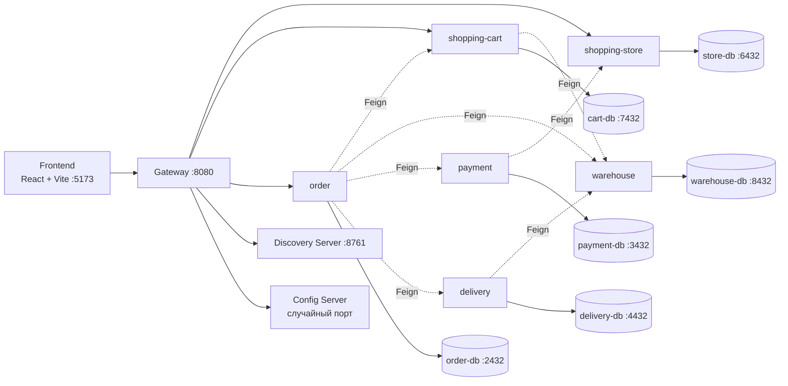
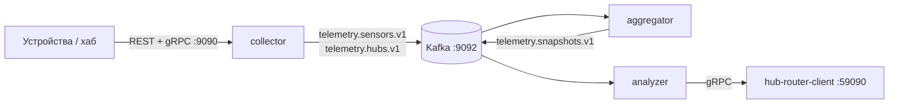

# Plus Smart Home Tech

Учебный проект «умный дом»: микросервисный бэкенд и SPA-витрина магазина устройств.

Бэкенд построен на **Java 21 / Spring Boot 3.2** и **Spring Cloud 2023.0** (Eureka, Config Server,
Spring Cloud Gateway). Коммерческий домен разбит на шесть сервисов — каталог, корзина, склад,
платежи, доставка, заказы; у каждого своя PostgreSQL и общение через OpenFeign по именам из Eureka.
Телеметрия устройств идёт через Kafka (Avro-схемы) и gRPC: `collector → aggregator → analyzer →
hub-router-client`. Фронтенд — React 18 + Vite, ходит в бэкенд только через gateway и умеет
работать в демо-режиме без него.

## Стек

| Слой | Технологии |
| --- | --- |
| Язык и сборка | Java 21, Maven 3.9, multi-module |
| Фреймворки | Spring Boot 3.2.4, Spring Cloud 2023.0.3 |
| Инфраструктура | Eureka Server, Spring Cloud Config Server (`native`), Spring Cloud Gateway (WebFlux), Resilience4j |
| Межсервисное общение | OpenFeign, Spring Cloud LoadBalancer, CircuitBreaker |
| Данные | PostgreSQL 16.1, Spring Data JPA / Hibernate, `schema.sql` + `data.sql` |
| Телеметрия | Kafka 7.4.3 (confluent-local), Avro 1.11.3, Protobuf 3.23.4, gRPC 1.63 |
| Утилиты | Lombok 1.18.30, MapStruct 1.6.0, Bean Validation, Actuator, springdoc-openapi 2.6 |
| Фронтенд | React 18.3, React Router 6, Vite 5.4, JavaScript, CSS, Context API |

## Архитектура



Все сервисы commerce регистрируются в Eureka и слушают **случайный порт** (`server.port: 0`), брать
их адреса нужно из Eureka Dashboard. Конфигурация хранится не в сервисах, а в
config-server (`native`-профиль, файлы на classpath).

### Телеметрия



## Модули

| Модуль | Назначение |
| --- | --- |
| `infra/discovery-server` | Eureka Server, :8761 |
| `infra/config-server` | Config Server, `native`-профиль, случайный порт |
| `infra/gateway` | единая точка входа, маршруты `lb://`, :8080 |
| `commerce/interaction-api` | общие DTO, enum'ы, исключения, Feign-клиенты (библиотека) |
| `commerce/shopping-store` | каталог товаров |
| `commerce/shopping-cart` | корзина и бронирование |
| `commerce/warehouse` | склад, сборка заказа |
| `commerce/payment` | расчёт стоимости и платежи |
| `commerce/delivery` | расчёт и планирование доставки |
| `commerce/order` | оркестрация оформления заказа |
| `telemetry/serialization/avro-schemas` | Avro-схемы и генерация классов |
| `telemetry/serialization/proto-schemas` | Protobuf/gRPC-контракты и генерация стабов |
| `telemetry/collector` | приём телеметрии, REST + gRPC :9090 |
| `telemetry/aggregator` | агрегация событий датчиков в снапшоты |
| `telemetry/analyzer` | анализ сценариев, состояние в PostgreSQL |
| `telemetry/hub-router-client` | gRPC-сервер :59090 для хаба |
| `frontend` | SPA-витрина магазина |

## Быстрый старт

### Требования

- **JDK 21** — проект объявлен под `<java.version>21</java.version>`. На JDK 25 Lombok 1.18.30
  падает с `ExceptionInInitializerError: com.sun.tools.javac.code.TypeTag :: UNKNOWN`.
- Docker Desktop, Maven 3.9, Node.js 20+.
- В IntelliJ IDEA: `Project Structure → Project SDK = 21`, `Maven → Runner → JRE = 21`.

```bash
# JDK 21 в терминале (macOS)
export JAVA_HOME=$(/usr/libexec/java_home -v 21)

# общий модуль DTO нужен всем сервисам
mvn -DskipTests -pl commerce/interaction-api -am install
```

### 1. Базы данных и Kafka

```bash
docker compose up -d
docker compose ps
```

| Compose-сервис | Host-порт | БД / логин / пароль | Кто использует |
| --- | --- | --- | --- |
| `store-db` | 6432 | `store-db` / `store` / `store` | shopping-store |
| `cart-db` | 7432 | `cart-db` / `cart` / `cart` | shopping-cart |
| `warehouse-db` | 8432 | `warehouse-db` / `warehouse` / `warehouse` | warehouse |
| `payment-db` | 3432 | `payment-db` / `payment` / `payment` | payment |
| `delivery-db` | 4432 | `delivery-db` / `delivery` / `delivery` | delivery |
| `order-db` | 2432 | `order-db` / `order` / `order` | order |
| `db` | 5432 | `scenario-db` / `username` / `password` | телеметрия (analyzer) |
| `kafka` | 9092 | — | телеметрия |

Для магазина достаточно шести БД; `db` и Kafka нужны только телеметрии.

### 2. Инфраструктура

1. **Discovery Server** — `ru.yandex.practicum.discoveryserver.DiscoveryServer`, порт 8761.
   Проверка: <http://localhost:8761>.
2. **Config Server** — `ru.yandex.practicum.configserver.ConfigServer`, порт случайный.
   Дождитесь появления `CONFIG-SERVER` в Eureka — без него остальные сервисы не стартуют
   (`fail-fast: true`).

### 3. Сервисы магазина — в порядке зависимостей

`shopping-store` → `warehouse` → `shopping-cart` → `payment` → `delivery` → `order`

После каждого шага дождитесь регистрации в Eureka (до 30 с). `order` запускается последним: он
при оформлении вызывает `cart → warehouse → payment → delivery`.

### 4. Gateway

`ru.yandex.practicum.gateway.GatewayApplication`, порт 8080.

```bash
curl "http://localhost:8080/shopping-store?productCategory=LIGHTING&page=0&size=10"
# → 2 товара: Plus L1 и Plus L2 Color
```

### 5. Фронтенд

```bash
cd frontend
npm install
npm run dev
```

Открыть <http://127.0.0.1:5173>. Если порт занят: `npm run dev -- --port 5174`.
Подробности, проксирование API, чек-лист ручного тестирования и разбор проблем —
[`frontend/README.md`](frontend/README.md).

## Конфигурация

Config Server работает в `native`-режиме, файлы лежат в репозитории:

```
infra/config-server/src/main/resources/config/
├── commerce/<service>/application.yaml   # datasource, resilience4j
├── infra/gateway/application.yaml        # маршруты, CORS
└── telemetry/<service>/application.yaml  # kafka, gRPC
```

Изменения в этих файлах подхватываются на каждый запрос к config-server (после `Build` в IDEA,
чтобы ресурс попал в `target/classes`). Перезапуск нужен только при правке кода самого
config-server.

## Проверка цепочки через API

```bash
# каталог
curl "http://localhost:8080/shopping-store?productCategory=SENSORS&page=0&size=10"

# корзина: добавить товар
curl -X PUT "http://localhost:8080/shopping-cart?username=test-user" \
  -H "Content-Type: application/json" \
  -d '{"11111111-1111-1111-1111-111111111111": 2}'

# бронирование на складе
curl -X POST "http://localhost:8080/shopping-cart/booking?username=test-user"

# оформление заказа
curl -X PUT "http://localhost:8080/order" \
  -H "Content-Type: application/json" \
  -d '{
        "shoppingCart": {
          "shoppingCartId": null,
          "products": {"11111111-1111-1111-1111-111111111111": 2}
        },
        "deliveryAddress": {
          "country": "Россия", "city": "Москва", "street": "Тверская",
          "house": "1", "flat": "10"
        }
      }'
```

Ответ `PUT /order` — заказ с `orderId`, состоянием `ON_PAYMENT` и рассчитанными
`productPrice`, `deliveryPrice`, `totalPrice`.

## Особенности

- **8 товаров в БД** (`commerce/shopping-store/src/main/resources/data.sql`): 2 освещение,
  3 датчика, 3 контроль. Во фронтенде демо-каталог шире — 10 позиций.
- **`warehouse` при старте пересоздаёт таблицы** (`drop table if exists`) — остатки и брони
  сбрасываются, для тестов это нормально.
- **Фронтенд молча уходит в демо-режим**, если gateway или сервис недоступен: оформляется
  демо-заказ `PSH-XXXXXX` и появляется серая плашка. Это не ошибка интеграции, а fallback —
  при проверке смотрите Network и логи gateway.
- **Порты сервисов магазина случайные** — обращайтесь к ним через gateway или Eureka.
- **Смена сети ломает config-server в Eureka**: `preferIpAddress: true` фиксирует IP на момент
  старта. После смены Wi-Fi перезапустите Config Server.

## Частые проблемы

| Симптом | Решение |
| --- | --- |
| `ExceptionInInitializerError: TypeTag :: UNKNOWN` | сборка идёт на JDK 25 — переключите SDK и Maven Runner на 21 |
| `ConfigClientFailFastException`, `500` на `/<service>/default` | битый YAML в конфиге сервиса — проверьте `config/commerce/<service>/application.yaml` |
| `Connect timed out` к `192.168.x.x:<port>/.../default` | устаревший IP config-server в Eureka после смены сети — перезапустите Config Server |
| Gateway отдаёт 503 `Unable to find instance` | сервис не поднят или ещё не в Eureka; подождите ~30 с |
| `Port 8761/8080/5173 was already in use` | `lsof -ti :8761 \| xargs kill` (в IDEA останавливайте кнопкой **Stop**, процессы переживают закрытие вкладки) |
| `relation "products" does not exist` | не поднята БД или сервис стартовал раньше Postgres |

Полная таблица проблем и чек-лист ручного тестирования — в [`frontend/README.md`](frontend/README.md).

## Статус

Учебный проект Yandex Practicum. Ветка по умолчанию — `main`.
